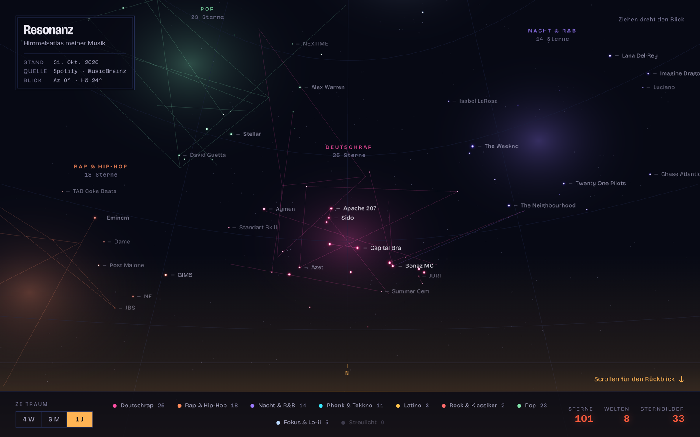

# Resonanz

**Deine Musik als begehbarer Sternenhimmel.** Jeder Künstler ein Stern, jede Hörwelt eine Galaxie, beim Scrollen ein eigener Rückblick. Gebaut aus der Spotify-Web-API und MusicBrainz, gezeichnet im Browser mit three.js. Kein Build, kein Server, nichts wird hochgeladen.

[English version](README.md) · Live: **[stefanpaun.page/resonanz](https://stefanpaun.page/resonanz/)**



## Was man sieht

- **Der Himmel.** Rund 200 Sterne, Größe nach Hörgewicht, Halo in der Farbe ihrer Welt. Künstler mit gemeinsamen Songs sind durch Sternbildlinien verbunden. Ziehen dreht den Blick, Pfeiltasten gehen auch, `Enter` öffnet den Stern in der Bildmitte.
- **Acht Welten.** Deutschrap, Rap & Hip-Hop, Nacht & R&B, Phonk & Tekkno, Latino, Rock & Klassiker, Pop, Fokus & Lo-fi (plus „Streulicht“ für Unzuordenbares). Die Zuordnung aus MusicBrainz-Tags steht in [`public/welten.js`](public/welten.js) und ist getestet.
- **Das Armaturenbrett.** Zeitraum-Schalter (4 Wochen · 6 Monate · 1 Jahr) mit Bernstein-Cursor, eine Legende, die den Himmel filtert, Messwerte in Rotlicht, die dem Zeitraum folgen.
- **Der Rückblick.** Scroll-Kapitel: deine Welten, was gerade läuft, Dauerbrenner, Verblasstes, Herkunft, Jahrgänge, zuletzt gehört. Jeder Text entsteht aus den Daten.
- **Sternkarten.** Stern oder Namen antippen: Plätze, Songs mit Cover und Dauer, Spotify-Link und eine 30-Sekunden-Vorschau, die erst beim Drücken von Deezer kommt.
- **Deutsch und Englisch.** Die Oberfläche folgt der Browsersprache; der Schalter `EN`/`DE` in der Kartusche (oder `?lang=en`) übersteuert sie.
- **Dein eigener Himmel.** Das ZIP des *erweiterten Streaming-Verlaufs* ablegen: Heatmap Wochentag × Stunde, Monate, Nachtanteil, Serien. Oder mit eigener Spotify-App anmelden (PKCE, im Browser). Alles bleibt im `localStorage`.
- **Mehr Quellen.** Dieselben Verlaufs-Kapitel gibt es mit der *Play Activity*-CSV von Apple Music, einem Last.fm-Export (CSV oder JSON von `user.getRecentTracks`) und der `watch-history.json` aus Google Takeout (nur YouTube-Music-Einträge). Die Quelle wird am Inhalt erkannt, nicht am Dateinamen. Die Leser liegen als reine Module in [`public/quellen/`](public/quellen/) um ein gemeinsames Eintragsformat (`t` in UTC, Künstler, Titel, optional Album und Hördauer, Quelle); Quellen ohne Hördauer zählen 3,5 Minuten pro Eintrag. Obergrenzen: 150 MB und 3 Mio. Zeilen, eingelesen in Portionen mit Fortschrittsanzeige. Nichts wird hochgeladen; die Testdateien sind erfunden.

## Starten

```bash
git clone https://github.com/Stefan-Paun/resonanz
cd resonanz
npm start          # python3 -m http.server 8742 --directory public
npm test           # node --test, keine Abhängigkeiten
```

Dann `http://127.0.0.1:8742/` öffnen. Die Demo nutzt den eingefrorenen Schnappschuss in `data/snapshot.json` (meiner, vom 31.10.2026).

## Zwei Himmel vergleichen

„Dein eigener Himmel“ → *Zwei Himmel vergleichen* exportiert deinen Himmel als kleine Datei (`resonanz-vergleich.json`, Formatversion 1) und legt die Datei eines anderen darüber. Gemeinsame Künstler leuchten in einer dritten Farbe; die drei Gruppen unterscheiden sich auch durch die Form (Kreis: nur du, Raute: nur der andere, Quadrat: beide). Ein Umschalter zeigt A, B oder beide, das Kapitel „Ihr zwei“ nennt die Zahlen, und *Vergleich beenden* bringt deinen Himmel ohne Neuladen zurück.

- **Die Datei enthält nur Aggregiertes:** Künstler-Kennungen und -Namen, Gewichte je Zeitraum (4 Wochen, 6 Monate, 1 Jahr), bis zu acht Genres je Künstler, eine gewichtete Genre-Liste, den Monat des Schnappschusses und einen frei getippten Anzeigenamen. Keine Hörzeitpunkte, keine Konto-Kennung, keine Links, keine Songs. Ein Test prüft die exportierten Felder gegen eine Zulassungsliste (`ERLAUBTE_FELDER` in [`public/austausch.js`](public/austausch.js)).
- **Strenger Import:** Version, Typen, Größe (256 KB) und Anzahlen werden geprüft, unbekannte Felder fallen weg, Steuerzeichen und spitze Klammern werden entfernt, Namen erscheinen per `textContent` oder escaped. Die fremde Datei bleibt im Speicher; nur die geprüfte Kopie wird abgelegt, und nur mit „merken“ (und bei jedem Lesen erneut geprüft).
- **Die Übereinstimmung** ([`public/vergleich.js`](public/vergleich.js)) ist der Mittelwert zweier Kosinus-Ähnlichkeiten, über Künstler- und über Genre-Gewichte; beide werden auch einzeln gezeigt. Künstler werden über die Kennung zugeordnet, ersatzweise über den normalisierten Namen. Listen: gemeinsam, nur A, nur B, Brücken (andere Künstler, gleiches Genre). Identische Himmel ergeben 100 %, disjunkte 0 %, und A und B zu vertauschen ändert nichts.

## Schnappschuss erneuern (Besitzer)

```bash
export SPOTIFY_CLIENT_ID=...          # von developer.spotify.com, nie ins Repo
python3 tools/sammeln.py login        # PKCE-Login im Browser, Token bleibt in tools/token.json (gitignored)
python3 tools/sammeln.py              # Spotify-Top-Listen + MusicBrainz-Tags → data/snapshot.json
```

Der Sammler ist reines Python ohne Pakete. MusicBrainz wird mit einer Anfrage pro Sekunde und lokalem Cache befragt; Künstler, die es nicht kennt, bekommen ihre Tags aus `data/ueberschreibungen.json`.

## Ehrliche Grenzen

- Seit Februar 2026 liefert die Spotify-Web-API im Development Mode **keine Genres, keine Popularität und keine Vorschauen** mehr, der App-Besitzer braucht Premium, und höchstens fünf Nutzer dürfen eingetragen sein. Deshalb kommen Genres von MusicBrainz und Vorschauen von Deezer, und deshalb braucht „mit eigenem Konto“ eine eigene Client-ID.
- „Zuletzt gehört“ sind die letzten 50 Songs. Ein echter Tagesrhythmus braucht den exportierten Streaming-Verlauf.
- Der Himmel ist ein Schnappschuss, kein Live-Bild.

## Datenschutz

Die Demo zeigt meine Künstler, Songs und Hörgewichte, ungefähr das, was ein öffentliches Spotify Wrapped zeigt. Nie dabei: Anzeigename, Playlists, E-Mail und **Uhrzeiten**: Der Sammler lässt die Abspielzeiten von „zuletzt gehört“ standardmäßig weg (`--mit-zeiten` behält sie für einen privaten Lauf). Der öffentliche Himmel sagt also, was ich höre, nicht wann. Der volle Tagesrhythmus (Heatmap, Monate, Serien) läuft immer nur lokal aus dem eigenen Export. Eigene Daten werden nur im Browser verarbeitet; die einzigen Aufrufe an Dritte sind MusicBrainz (Genres, beim Anmelden) und Deezer (Vorschau, beim Drücken auf Play).

## Dank

Metadaten und Cover gehören Spotify und den Rechteinhabern; das hier ist ein privates Projekt ohne Verbindung zu Spotify. Genres und Länder von [MusicBrainz](https://musicbrainz.org). Vorschauen von [Deezer](https://developers.deezer.com). three.js (MIT). Schriften: Bricolage Grotesque und Azeret Mono (SIL OFL), selbst gehostet.

three.js liegt in `public/vendor/` (kein CDN zur Laufzeit). Genre-Tags von MusicBrainz stehen unter CC BY-NC-SA 3.0; das Projekt ist nicht kommerziell. Eine strenge Content-Security-Policy beschränkt die Seite auf eigene Dateien plus Spotify (Login, API, Cover), MusicBrainz und Deezer.

MIT-Lizenz. Gebaut von Stefan Paun, 17, Wien, mit Claude Code.
