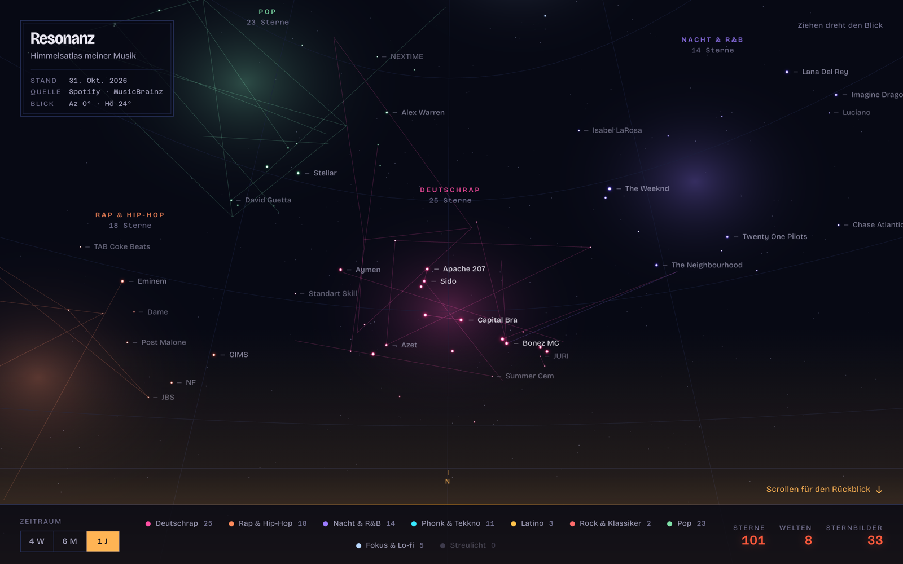

# Resonanz

**Your music as a walkable night sky.** Every artist is a star, every listening world a galaxy, and scrolling takes you through your own retrospective. Built from the Spotify Web API and MusicBrainz, rendered in the browser with three.js. No build step, no server, nothing uploaded.

[Deutsche Fassung](README.de.md) · Live: **[stefanpaun.page/resonanz](https://stefanpaun.page/resonanz/)**



## What you see

- **The sky.** ~200 stars, sized by how much you listen, haloed in the colour of their world. Artists who share songs are joined by constellation lines. Drag to look around, arrow keys work too, `Enter` opens the star nearest the centre.
- **Eight worlds.** German rap, Rap & hip-hop, Night & R&B, Phonk & techno, Latin, Rock & classics, Pop, Focus & lo-fi (plus "stray light" for the unclassifiable). The mapping from MusicBrainz tags lives in [`public/welten.js`](public/welten.js) and is tested.
- **The instrument panel.** Period switch (4 weeks · 6 months · 1 year) with an amber cursor, a legend that filters the sky, red-light readouts that follow the period.
- **The retrospective.** Scroll chapters: your worlds, what's new, the ever-burning, what faded, where the sound comes from, release years, what you played last. All text is generated from the data.
- **Star cards.** Tap a star or a name: ranks, songs with covers and length, a Spotify link, and a 30-second preview fetched from Deezer only when you press play.
- **German and English.** The interface follows your browser language; the `EN`/`DE` switch in the cartouche (or `?lang=en`) overrides it.
- **Your own sky.** Drop the ZIP of your Spotify *Extended Streaming History* for an hour-by-weekday heatmap, months, night share and streaks. Or sign in with your own Spotify app (PKCE, in the browser). Everything stays in `localStorage`.

## Run it

```bash
git clone https://github.com/Stefan-Paun/resonanz
cd resonanz
npm start          # python3 -m http.server 8742 --directory public
npm test           # node --test, 31 tests, no dependencies
```

Open `http://127.0.0.1:8742/`. The demo uses the frozen snapshot in `data/snapshot.json` (mine, from 31 Oct 2026).

## Refresh the snapshot (owner)

```bash
export SPOTIFY_CLIENT_ID=...          # from developer.spotify.com, never committed
python3 tools/sammeln.py login        # PKCE login in the browser, token stays in tools/token.json (gitignored)
python3 tools/sammeln.py              # Spotify top items + MusicBrainz tags → data/snapshot.json
```

The collector is standard-library Python. MusicBrainz is queried at one request per second with a local cache; artists it does not know get their tags from `data/ueberschreibungen.json`.

## Honest limits

- Since February 2026 the Spotify Web API in development mode gives **no genres, no popularity and no previews**, the app owner needs Premium, and at most five users can be allowlisted. That is why genres come from MusicBrainz and previews from Deezer, and why "sign in with your own account" needs your own client ID.
- "Recently played" is the last 50 tracks. A real daily rhythm needs the exported streaming history.
- The sky is a snapshot, not a live view.

## Privacy

The demo shows my artists, songs and listening weights. It never contains a display name, playlists or an email. Your own data, when you load it, is processed in your browser only; the only third-party calls are MusicBrainz (genres, when you sign in) and Deezer (previews, when you press play).

## Credits

Metadata and cover art belong to Spotify and the rights holders; this is a private project not affiliated with Spotify. Genres and countries from [MusicBrainz](https://musicbrainz.org). Previews from [Deezer](https://developers.deezer.com). three.js (MIT). Fonts: Bricolage Grotesque and Azeret Mono (SIL OFL), self-hosted.

three.js is vendored in `public/vendor/` (no CDN at runtime). Genre tags from MusicBrainz are CC BY-NC-SA 3.0; this project is non-commercial. A strict Content-Security-Policy limits the page to its own files plus Spotify (login, API, covers), MusicBrainz and Deezer.

MIT License. Built by Stefan Paun, 17, Vienna, with Claude Code.
